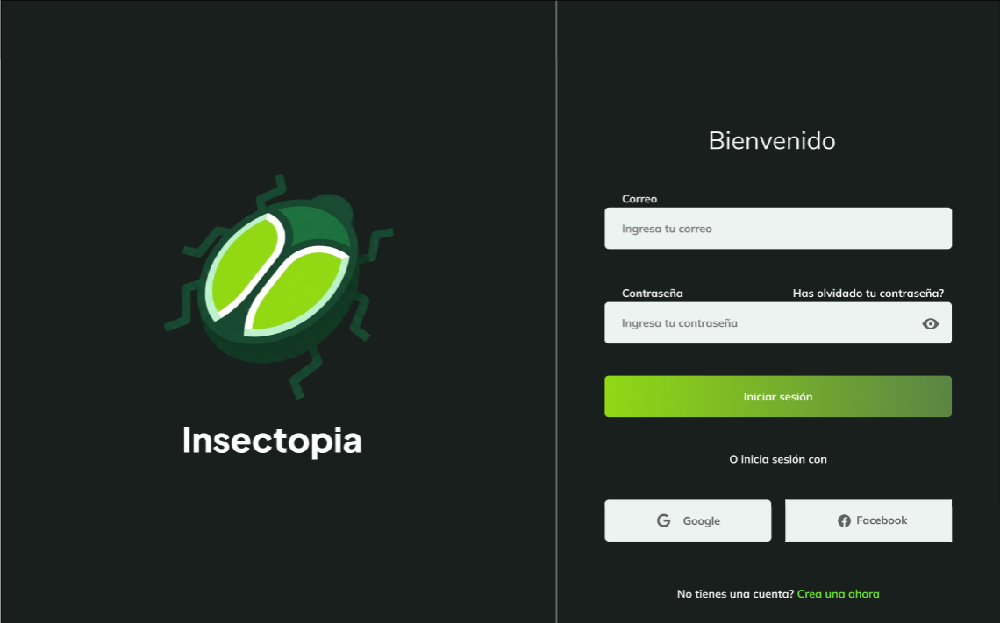
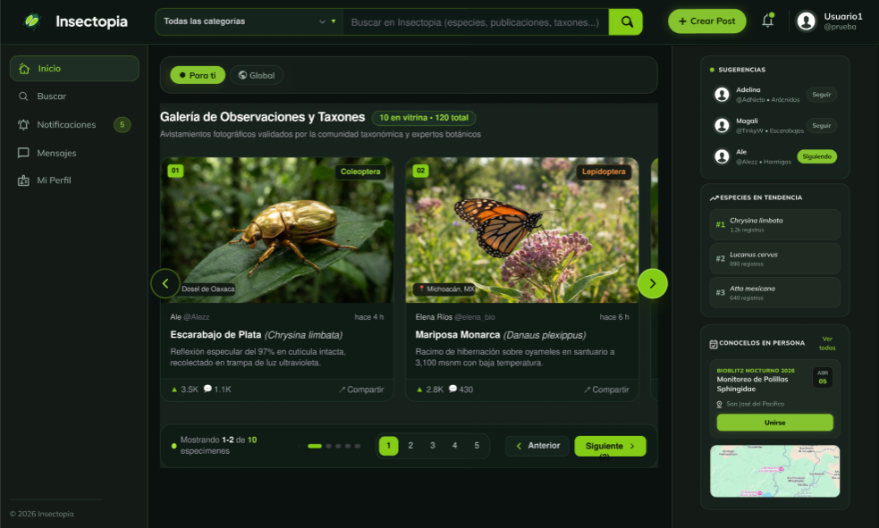

# Insectopia — Act8. Consumo de APIs de Terceros - Login y Sistema con Tabla CRUD
---
### Integrantes del Equipo (Equipo 06)
- **Diego Revilla Magali Sarai**
- **Jimenez Victoria Alejandro**

### API Elegida para la Tabla de Datos
- **API de Observaciones (Tabla / Galería CRUD):** **iNaturalist API**
  * **Endpoint Base:** `https://api.inaturalist.org/v1/observations`
  * **Estructura de la Consulta Dinámica:**
    ```text
    https://api.inaturalist.org/v1/observations?taxon_id=${order.id}&quality_grade=research&photos=true&per_page=15&locale=es
    ```
  * **Filtrado Dinámico por Especie/Orden (`taxon_id`):** En `productsService.js`, el parámetro `${order.id}` se reemplaza dinámicamente en tiempo de ejecución para consultar en paralelo únicamente los especímenes de cada categoría seleccionada:
    * `47208`: **Coleoptera** (Escarabajos)
    * `47157`: **Lepidoptera** (Mariposas y polillas)
    * `47201`: **Hymenoptera** (Abejas, avispas y hormigas)
    * `47792`: **Odonata** (Libélulas)
    * `48112`: **Mantodea** (Mantis)
    * `47119`: **Arachnida** (Arácnidos)
  * **Parámetros de Calidad y Localización:**
    * `quality_grade=research`: Filtra únicamente observaciones con "grado de investigación" validadas por la comunidad científica.
    * `photos=true`: Asegura que todas las observaciones contengan registros fotográficos reales.
    * `per_page=15`: Solicita 15 registros por cada orden, consolidando un catálogo de hasta 90 especímenes.
    * `locale=es`: Devuelve nombres comunes preferidos en español (`preferred_common_name`).
- **API de Autenticación (Login):** **DummyJSON Auth API**
  * **Endpoint:** `https://dummyjson.com/auth/login`
  * **Credenciales de acceso:** Usuario: `emilys` | Contraseña: `emilyspass`

### Link al Proyecto Desplegado en el VPS
- **URL del Proyecto en el VPS:** [http://67.205.147.44/t3_act8_eq6](http://67.205.147.44/t3_act8_eq6)

---

## Funcionalidades Principales

1. **Autenticación y Rutas Protegidas (`LoginPage.jsx`, `authService.js`):**
   * Inicio de sesión conectado a DummyJSON con validación de campos y manejo de errores.
   * Protección de rutas con `react-router-dom` que redirige a `/login` si no existe sesión activa.
2. **Layout Principal (`Navbar.jsx`, `Sidebar.jsx`):**
   * Barra superior con foto y nombre del usuario autenticado, buscador, selector de categorías y botón de cierre de sesión.
   * Menú lateral colapsable y panel derecho de comunidad (*Sugerencias* y *Especies en Tendencia*).
3. **Consumo de API, Filtros, Paginación y CRUD (`DashboardPage.jsx`, `productsService.js`, `ProductModal.jsx`, `ConfirmModal.jsx`):**
   * Peticiones paralelas mediante `Promise.all` al endpoint de iNaturalist con los `taxon_id` específicos para cargar los distintos órdenes biológicos en la galería.
   * Búsqueda en tiempo real, filtro por categoría y paginación sincronizada con parámetros URL (`?page=1&limit=10`).
   * Modales para crear nuevas observaciones, editar registros existentes y confirmar eliminación.
   * **Nota sobre operaciones de escritura (`POST`, `PUT`, `DELETE`):** Dado que la API pública de iNaturalist es de solo lectura para usuarios no autenticados por OAuth (para proteger su base de datos científica), las peticiones de creación, edición y eliminación en `productsService.js` se envían hacia los endpoints REST de prueba de **DummyJSON** (`https://dummyjson.com/products`), permitiendo ejecutar peticiones HTTP reales con respuesta `200 OK` y reflejar los cambios en el estado local (`useState`) de la galería.

---

## Tecnologías Utilizadas
- **React 18 + Vite**
- **Tailwind CSS**
- **React Router DOM**
- **Lucide React** (Iconografía)
- **Google Fonts** (*Plus Jakarta Sans* y *Mulish*)

---

## Capturas de pantalla


